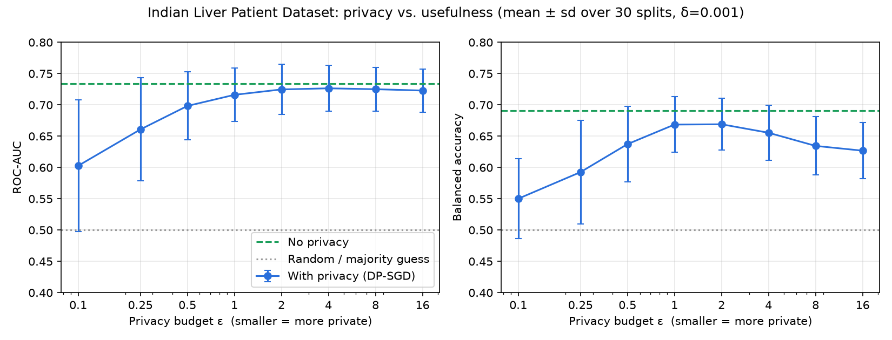

# What does privacy cost? Training on Indian health data with differential privacy

India's IT ministry (MeitY) has proposed **DEPA for AI training** (Data Empowerment and Protection Architecture). The idea is that a company can train an AI model on sensitive data, such as hospital records, **without ever seeing the data**. The model is sent to where the data lives and trains inside a locked, secure computing environment called a *confidential clean room*.

This repo tries out one part of that idea on a laptop: **differential privacy (DP)**. I train the same small neural network on real Indian patient records twice, once normally and once with [Opacus](https://opacus.ai/) (PyTorch's DP library), and measure how much accuracy privacy costs.



## TL;DR

| Setting | ROC-AUC | Balanced accuracy | Plain accuracy |
|---|---|---|---|
| Always guess "patient" | 0.500 | 0.500 | **0.709** ← looks good, but useless |
| **No privacy** | **0.734** | **0.691** | 0.634 |
| DP, ε = 16 | 0.723 | 0.627 | 0.675 |
| DP, ε = 8 | 0.725 | 0.634 | 0.672 |
| DP, ε = 4 | 0.726 | 0.655 | 0.667 |
| DP, ε = 2 | 0.725 | 0.669 | 0.655 |
| **DP, ε = 1** | **0.716** | **0.669** | 0.642 |
| DP, ε = 0.5 | 0.698 | 0.637 | 0.631 |
| DP, ε = 0.25 | 0.661 | 0.593 | 0.606 |
| DP, ε = 0.1 | 0.603 | 0.550 | 0.570 |

*Mean over 30 random 80/20 train/test splits, δ = 0.001. Standard deviations are in [`results/summary.csv`](results/summary.csv).*

- **At ε = 1 (a strong, commonly cited privacy level), privacy costs about 2 points of AUC** (0.734 → 0.716). That gap is smaller than the run-to-run noise from picking a different train/test split (±0.04).
- **Below ε ≈ 0.5 the model degrades quickly.** At ε = 0.1 it is barely better than a coin toss.
- **Plain accuracy is a trap on this dataset.** 71% of the patients have liver disease, so "always say yes" scores 71%. The DP models' plain accuracy *rises* with ε while their balanced accuracy *falls*, because the noisy models drift toward predicting the majority class. Always check balanced accuracy or AUC on imbalanced medical data.

## The dataset

[Indian Liver Patient Dataset (ILPD)](https://archive.ics.uci.edu/dataset/225/ilpd+indian+liver+patient+dataset) from the UCI ML Repository (CC BY 4.0). It has 583 patients from north-east Andhra Pradesh with 10 features: age, gender, bilirubin, liver enzymes (ALT, AST, alkaline phosphatase), proteins, albumin and the A/G ratio. The label is whether the patient has liver disease (416 yes, 167 no).

It is a small, noisy dataset. Published models typically reach AUC around 0.70–0.75, so a 0.734 baseline is in the normal range.

## What differential privacy actually does

Normal training (SGD) looks at a batch of patients, computes how each one should nudge the model, averages the nudges and updates the model. A single unusual patient can leave a recognisable fingerprint on the model, and attacks such as *membership inference* can sometimes tell whether a given person was in the training data.

**DP-SGD** (what Opacus implements) changes two things:

1. **Clip** each patient's nudge to a maximum size (`max_grad_norm = 1.0`), so no single person can pull the model too far.
2. **Add random noise** to the combined nudge before updating the model, enough to hide whether any one person was included at all.

The amount of noise is set by the **privacy budget ε (epsilon)**:

- **Small ε** (0.1–1): strong guarantee, lots of noise, lower accuracy.
- **Large ε** (8+): weak guarantee, little noise, accuracy close to normal.

Roughly, ε limits how much more likely any outcome becomes because *your* record was in the data (by a factor of up to e^ε). **δ** is the small chance that guarantee fails; it should be well below 1/(number of people), so I used 0.001 for 466 training patients.

Opacus works out the noise needed for a target ε (the `noise_multiplier` column in `summary.csv`). It ranges from 35× the clipping size at ε = 0.1 down to 0.77× at ε = 16.

## How this maps to DEPA

DEPA-style training combines two protections that solve **different** problems:

| Protection | What it stops | In this repo? |
|---|---|---|
| **Confidential clean room** (secure hardware enclave; the model goes to the data) | The company or anyone else *seeing the raw records during training* | No, it needs special hardware (Intel SGX/TDX, AMD SEV, confidential GPUs) |
| **Differential privacy** | The *finished model* leaking facts about individual patients after it leaves the clean room | **Yes**, via Opacus |

A clean room alone is not enough: a model that comes out of the clean room could still have memorised individual records. DP alone is not enough either: someone still has to hold the raw data to run the training. Together, nobody sees the data while the model trains, and the model that comes out can't easily be used to recover individuals.

This experiment shows the price of the second half. **For a simple tabular model at a moderate privacy level (ε ≈ 1–4), the price is small.**

## Why the trade-off looks like this

- **Small data makes privacy expensive.** The noise needed to hide one person is fixed, but the useful signal grows with the number of people. With only 466 training rows the noise stands out, and with 466,000 it would mostly average away. Large collections of records, such as national health datasets, should see a much smaller DP cost than this toy example.
- **Small models make privacy cheap.** Fewer parameters means less noise in total. This network has about 900 weights; large deep networks pay much more.
- **DP also acts as a regulariser.** The unprotected model overfits this tiny dataset quickly, so I tuned its training length (20 epochs, lr 0.001) to make the comparison fair. An untuned baseline trained for longer actually did *worse* than the DP model.

## Caveats

- **Not everything is private.** The feature scaling (means, standard deviations, medians) uses training data without DP. A real deployment would compute those privately too or fix them in advance.
- **Hyperparameter tuning spends privacy too** in a strict accounting. I tuned on separate random splits (seeds 10–29) and report results on seeds 0–29 using the same 583 patients, which is the usual practice in papers but not a formal guarantee.
- **The test sets are small** (117 patients), so individual runs vary by about ±0.04 AUC. That is why I report averages over 30 splits.
- **No secure enclave is used.** This demonstrates the DP side of DEPA only.

## Run it yourself

```bash
python3 -m venv .venv && source .venv/bin/activate
pip install torch --index-url https://download.pytorch.org/whl/cpu
pip install -r requirements.txt
./download_data.sh
python train.py            # ~2 minutes on a laptop CPU; writes results/
python train.py --seeds 3  # quick check
```

Outputs:

- `results/summary.csv`: the table above, with standard deviations and noise levels
- `results/all_runs.csv`: every individual run
- `results/privacy_tradeoff.png`: the chart
- `results/config.json`: settings used

## Setup details

- **Model:** MLP 10 → 32 → 16 → 1, ReLU, BCE loss weighted for class imbalance
- **Pre-processing:** log-transform skewed lab values, median-fill 4 missing A/G ratios, standardise
- **No privacy:** Adam, lr 0.001, 20 epochs, batch 64
- **DP:** Opacus 1.6 `make_private_with_epsilon`, RDP accountant, Poisson sampling, Adam lr 0.005, 20 epochs, expected batch 64, clip norm 1.0, δ = 1e-3
- **Evaluation:** stratified 80/20 split, repeated for 30 seeds
